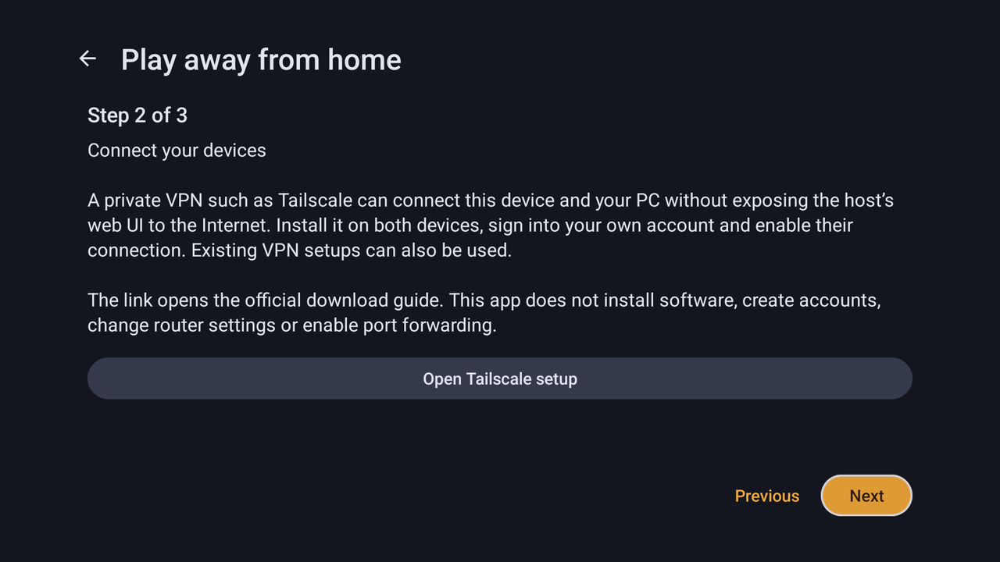

# Play away from home

[Nightjar docs](index.md) › [Play anywhere](index.md#play-anywhere) · [Pairing](pairing.md) · [Troubleshooting](TROUBLESHOOTING.md)

Nightjar streams from outside the home network over a private VPN such as Tailscale, which connects this device and the PC without exposing the host to the Internet, or, with a PC that offers it, [without a VPN](#without-a-vpn). Nightjar does not install software, change router settings, open public ports or create accounts. The guide works with any paired Moonlight-compatible host.

## Set up on Android

Long-press a saved PC, choose **PC settings…**, then **Play away from home**. The guide has three steps:

1. **Prepare at home.** Pair on the home network, check that a normal stream works, and keep the PC awake. Waking a sleeping PC from outside needs an always-on device on the home network, such as a [wake relay](#wake-the-pc-from-away); the guide does not set one up.
2. **Connect your devices.** **Open Tailscale setup** opens the official installation guide. Install Tailscale on the PC and on this device, sign in to your own account on both, and enable the connection. An existing VPN works as well. If Nightjar does not find the PC on the VPN, save its VPN address with **Add address**.
3. **Test this PC.** Switch this device to another network, such as mobile data, and run the test. It sends five small HTTPS requests that verify the paired PC's certificate. It does not start a game or a stream, measure bandwidth or change the host, and leaving the screen cancels it.

  

## Without a VPN

**Settings → Streaming → Play over the internet** (on by default) reaches a PC without a VPN or port forwarding when its host offers it (Rubylight with Play over the internet on). Away from home, Nightjar tries the local network, then the PC's IPv6 address, then a forwarded port, and only then a direct path that both sides punch through their routers, found through a public peer-to-peer directory that holds only encrypted notes ([Privacy](PRIVACY.md)). Connect once on the PC's network first, so the PC can give this device its key. The PC's line names the path in use, and when none works it lists each path and why it failed.

A VPN still works where this cannot: two routers that both change ports per destination can't be punched through. Turn the setting off to never look up or punch a path.

## Wake the PC from away

Wake-on-LAN's magic packets don't cross the internet, so a sleeping PC can't be woken from away on its own. With a Rubylight PC that offers it, a wake relay does it for you: an always-on computer on the PC's network, such as a Linux mini PC, that runs desktop Nightjar's `nightjar wake-relay` ([how to run one](../protocol/desktop/README.md#away-wake-relay)). Set it up once:

1. Pair the relay computer with the PC in Nightjar, on the PC's network.
2. In the Rubylight console, turn on **Host control** for the relay and **Away wake relay** with Play over the internet ([the PC's side](https://github.com/RamazanKara/Rubylight/blob/main/docs/internet-play.md#away-wake-relay)).
3. Keep `nightjar wake-relay` running on it.
4. Connect this device once on the home network, so the PC gives it its wake access.

Away from home, waking the PC on Android asks the relay, through the same direct paths as [Play over the internet](#without-a-vpn), and says how it went: the wake signal sent, then the PC awake, or why not, for example the relay is offline or not on the PC's network, too many wake requests in a short time, a refused request (check this device's clock, or connect once at home to refresh its wake access), or a PC that did not answer within 45 seconds. When the PC offers waking from away but has no relay yet, Nightjar says that it can't be woken from outside the home network and how to set one up.

## Home network, Tailscale/VPN and Internet

Nightjar distinguishes three kinds of address when polling a PC and choosing stream settings:

- **Home network (LAN):** private RFC 1918 IPv4 addresses (`10.0.0.0/8`, `172.16.0.0/12`, `192.168.0.0/16`) and standard local IPv6 ranges (`fc00::/7`, `fe80::/10`, excluding Tailscale's overlay prefix).
- **Private overlay VPN (Tailscale / CGNAT):** `100.64.0.0/10` (RFC 6598 Shared Address Space) and Tailscale's `fd7a:115c:a1e0::/48` IPv6 prefix. These are **not** treated as public WAN addresses and **not** treated as LAN; Nightjar keeps conservative VPN packet sizing (`1024` bytes) and skips LAN-only probes.
- **Public Internet (WAN):** publicly routable IPv4/IPv6 addresses (port forwarding) and punched **Play over the internet** paths.

When a PC has multiple addresses (for example a home LAN IP, a Tailscale `100.x.y.z` IP, and an IPv6 or forwarded WAN address), Nightjar keeps the extra addresses alongside the primary slots and probes them in precedence order (**local LAN → manual/VPN → IPv6 → remote WAN → extra saved addresses**, then **Play over the internet** punch only when direct paths fail). Adding a third address preserves earlier endpoints instead of overwriting them, and pinning an address restricts polling to that single endpoint.

## Test from Windows and Linux

In the PC's details, **Play away from home → Remote access → Test this PC** runs the same five-request check of the paired PC. The Tailscale setup steps are the same as above.

## Reading the result

A successful test confirms that the paired host is reachable from the current network and presents its paired identity. The response time includes the host's request processing, and a failed request is not a measure of video packet loss. The streaming ports and sustained bandwidth are only exercised by a real stream, and a test run from inside the home network cannot show whether remote access works.

Hosts that support it (Rubylight 3.0) also report the current Tailscale route to this device: **direct**, **DERP relay**, **peer relay** or **unknown**. The report covers only the requesting device's active route and contains no addresses, other peers, names, keys or account details. A relayed route works but can add delay; compare with a direct route where one is possible. Other VPNs, subnet routers, idle peers and hosts without the report show **unknown** rather than a guess. The guide never sends traffic to force a direct route.
